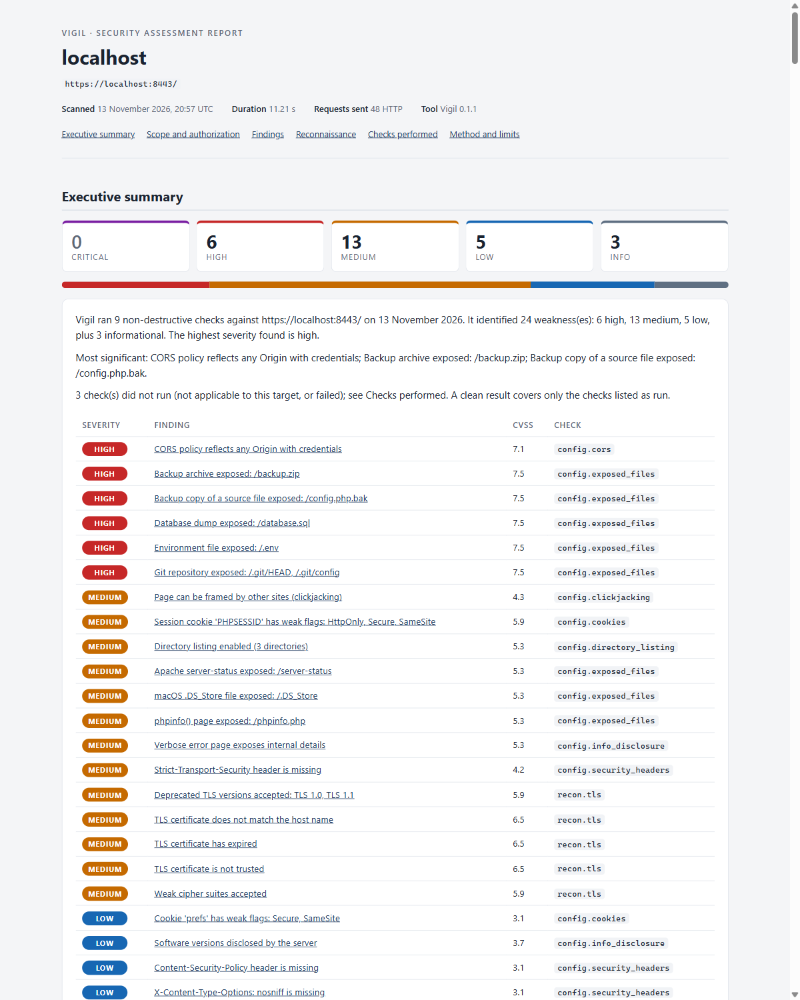

# Vigil

A web application security scanner for **authorized** testing — the "breaker" counterpart to SpecTackle's "builder."

> **Legal notice.** Only scan systems you own or have explicit written permission to test. Scanning anything else is illegal in most jurisdictions. Vigil refuses to run against a non-local target until you assert that authorization, and it never contacts a host you did not name. See [SCOPE-AND-ETHICS.md](SCOPE-AND-ETHICS.md).

## What it is

Vigil performs reconnaissance and non-destructive vulnerability **detection** against web applications you own or are explicitly authorized to test. It identifies security weaknesses and produces a professional, client-ready report with the evidence for every finding.

It follows the model of production tools (Nessus "safe checks", Burp's scan profiles, OWASP ZAP): detection by careful probing and response analysis — not destructive exploitation. That is the professional standard, and it is what keeps the tool legal to run and safe on a live target.



The full sample is in [docs/sample-report.html](docs/sample-report.html) (and [JSON](docs/sample-report.json)): a scan of the deliberately vulnerable test app that ships in `tests/fixtures/`.

## Status

**v0.1.1** — core engine, 12 recon and configuration checks, HTML and JSON reports. Site mapping, authenticated scanning and passive risk flags are planned for v2; see [ROADMAP.md](ROADMAP.md) and [V2-PLAN.md](V2-PLAN.md).

## Install

Python 3.11 or newer.

```
git clone <this repository>
cd Vigil
python -m venv .venv
.venv\Scripts\activate          # Windows;  source .venv/bin/activate elsewhere
pip install -e ".[dev]"
```

## Usage

Scan something you own:

```
vigil scan https://app.example.com --i-have-authorization
```

The scan prints a summary and writes `vigil-report.html`, `vigil-report.json` and `audit.log` to `./vigil-out` (change with `--output`).

| Command | What it does |
|---|---|
| `vigil scan URL` | Scan one target. |
| `vigil list-checks` | List the registered checks (`--markdown` prints the table below). |
| `vigil report FILE.json` | Re-render the HTML report from a JSON export, without scanning again. |

Useful `scan` options:

| Option | Default | Meaning |
|---|---|---|
| `--i-have-authorization` | off | Assert that you own the target or hold written permission. |
| `--scope FILE` | none | Scope file: extra hosts, exclusions, stored authorization. |
| `--output DIR`, `-o` | `vigil-out` | Where reports and the audit log go. |
| `--format` | `html,json` | Report formats. |
| `--checks`, `--skip` | all | Check ids or categories (`recon`, `config`), comma separated. |
| `--rate` | `5` | Maximum requests per second to a host. |
| `--concurrency` | `5` | Maximum simultaneous requests. |
| `--timeout` | `10` | Per-request timeout in seconds. |
| `--ca-bundle FILE` | none | Extra CA certificates the TLS check should trust (internal CAs). |
| `--verbose`, `-v` | off | Log each check as it finishes. |

Exit code is `0` when the scan completes (whatever it finds) and `2` when it is blocked by the scope gate or given bad arguments.

### Scope and authorization

Two conditions must both hold before any request is sent.

**1. The destination is in scope.** Scope is the set of hosts you named. By default that is exactly the host in the URL on the command line. Links, redirects and subdomains that lead anywhere else are listed in the report and never followed. There is no option that turns this off.

**2. You have asserted authorization**, in any one of three ways:

- `--i-have-authorization` on the command line;
- `VIGIL_AUTHORIZED=1` in the environment, for CI or a dev shell;
- an `authorization:` block in a scope file, for repeat engagements.

Loopback targets (`localhost`, `127.0.0.1`, `::1`) need no assertion. Every scan logs which assertion was used, with a timestamp, and the report prints it.

A scope file is only needed to go beyond one host:

```yaml
# scope.yaml
hosts:                 # in scope in addition to the command-line target
  - api.example.com
include_subdomains: false
exclude_paths:         # never requested
  - /logout
  - /admin/delete*
authorization:
  asserted_by: Jane Operator
  date: 2026-11-13
  basis: written-permission   # or: owned
```

```
vigil scan https://app.example.com --scope scope.yaml
```

## Checks

<!-- checks:start -->
| ID | Check | Category | Max severity | CWE | OWASP Top 10:2025 |
|---|---|---|---|---|---|
| `recon.dns` | DNS records and zone posture | recon | low | CWE-693 | A06:2025 Insecure Design |
| `recon.email_auth` | Email authentication (SPF, DMARC, DKIM) | recon | medium | CWE-290 | A07:2025 Authentication Failures |
| `recon.fingerprint` | Technology fingerprinting | recon | info | CWE-200 | A01:2025 Broken Access Control |
| `recon.subdomains` | Passive subdomain enumeration | recon | info | CWE-200 | A01:2025 Broken Access Control |
| `recon.tls` | TLS and certificate analysis | recon | medium | CWE-326 | A04:2025 Cryptographic Failures |
| `config.clickjacking` | Clickjacking exposure | config | medium | CWE-1021 | A06:2025 Insecure Design |
| `config.cookies` | Cookie flags | config | medium | CWE-1004 | A02:2025 Security Misconfiguration |
| `config.cors` | CORS misconfiguration | config | high | CWE-942 | A02:2025 Security Misconfiguration |
| `config.directory_listing` | Directory listing enabled | config | medium | CWE-548 | A01:2025 Broken Access Control |
| `config.exposed_files` | Exposed sensitive files | config | high | CWE-538 | A01:2025 Broken Access Control |
| `config.info_disclosure` | Server and version disclosure | config | medium | CWE-200 | A01:2025 Broken Access Control |
| `config.security_headers` | Security headers | config | medium | CWE-693 | A06:2025 Insecure Design |
<!-- checks:end -->

The table is generated: `vigil list-checks --markdown`. A test fails if it drifts from the registry.

OWASP categories are not assigned by hand: each one is derived from the finding's CWE, using the mapped-CWE lists published with the official [OWASP Top 10:2025](https://owasp.org/Top10/2025/). The table shows each check's primary CWE; individual findings can carry a more specific CWE and therefore a different category (an expired certificate is CWE-298, A07 Authentication Failures; a stack trace is CWE-209, A10 Mishandling of Exceptional Conditions).

Every finding carries a CVSS v3.1 vector and score, a CWE and its OWASP Top 10:2025 category, the request that was sent, the relevant part of the response, why it was flagged, and how to fix it. Secret values and cookie values are masked in evidence, and exposed backups are identified from their first bytes rather than downloaded.

## How it is built

```
vigil/
  cli.py        scan, list-checks, report
  scope.py      scope + authorization gate; the only source of a Permit
  http.py       async client: scope check, rate limit, retries, evidence capture
  engine.py     runs checks concurrently, isolates failures, builds the result
  models.py     Target, Finding, Evidence, Severity, ScanResult
  checks/       one module per check, discovered automatically
  report/       HTML (Jinja2) and JSON renderers
tests/fixtures/ local vulnerable + clean test app, DNS server, test certificates
```

- **Checks are plugins.** A check is a class with metadata and an async `run(target, ctx)`. Adding a module under `vigil/checks/` is all it takes; the engine knows nothing about individual checks.
- **The gate is structural.** The HTTP client and the engine cannot be constructed without a `Permit`, and `scope.authorize()` is the only thing that issues one. Every HTTP request and TLS handshake is checked against scope at the point it is sent.
- **Polite by default.** Per-host rate limit, bounded concurrency, backoff, `Retry-After` honoured, an identifiable `User-Agent`, read-only methods only.

Design choices and their reasons are in [DECISIONS.md](DECISIONS.md).

## Development

```
pytest          # everything runs against local fixtures; no test touches the internet
ruff check .
```

Each check has a pair of tests: it fires on the vulnerable fixture and stays silent on the clean one. The clean fixture answers unknown paths with HTTP 200 on purpose, to catch false positives.

Run the fixture app by hand, or regenerate the sample report:

```
python -m tests.fixtures.app --mode vulnerable --port 8808
vigil scan http://localhost:8808

python scripts/make_sample_report.py
```

### Optional: OWASP Juice Shop

A larger, deliberately vulnerable target that is legal to scan. Not required for `pytest`.

```
docker run --rm -p 3000:3000 bkimminich/juice-shop
vigil scan http://localhost:3000
```

## Positioning

- **SpecTackle** → ships websites.
- **Vigil** → tests them.

One builder, one breaker. Together they tell a single portfolio story.

## Legal

Running this against systems you do not own or have written permission to test is illegal in most jurisdictions (e.g. unauthorized-access statutes). See [SCOPE-AND-ETHICS.md](SCOPE-AND-ETHICS.md). The authorization gate exists to make misuse a deliberate act, not an accident.

Released under the [MIT License](LICENSE).
